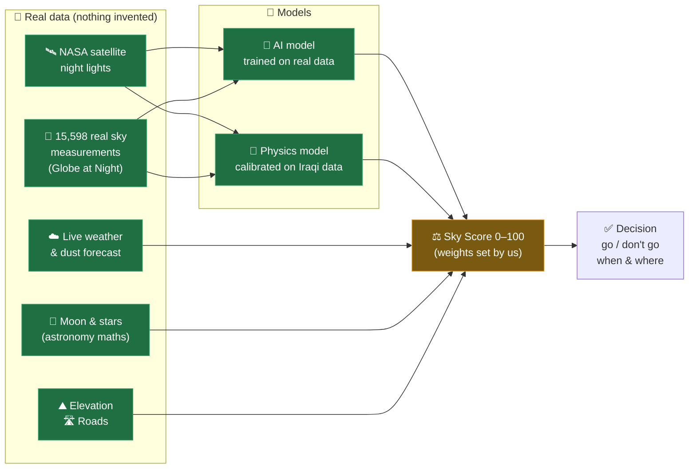
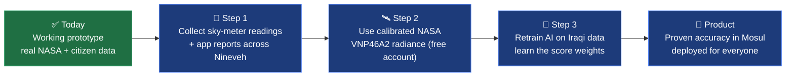
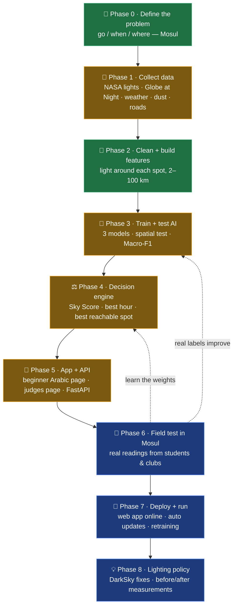

# SkyQ Mosul — light pollution & observation-quality prototype (study area: Mosul / Nineveh)

## Primary experience: هلال العراق — Ramadan and Eid

The app now opens on an Arabic crescent-observation planner for Ramadan, Shawwal / Eid al-Fitr and Dhu al-Hijjah / Eid al-Adha. Choose an Iraqi city or coordinates and a Hijri year to calculate three observing evenings, inspect sunset/moonset and pointing direction, export a CSV plan, and download an unverified observation record. Existing stargazing pages remain available.

This is a **visibility planning tool, not an official month announcement**. Atmospheric adjustments are experimental and shown only with complete near-term inputs; distant dates show geometry only. No official announcement feed, central report database or verified site ranking is connected. See [feature plan](plans/ramadan-feature.md) for the pitch, differences from alternatives, evidence and validation roadmap. Run `python -m unittest test_crescent -v` to check the new flow.

ASI Hackathon · Challenge 1: التلوث الضوئي وصعوبة الرصد الفلكي

**Problem.** Iraqi observers (e.g. University of Baghdad, Dept. of Astronomy & Space) lose nights to city sky glow,
dust/haze, clouds, moonlight and turbulence. The usual way to find out a night is bad is to drive out and try.

**Two pages:** **سما الموصل** (public, Iraqi Arabic, for beginners): answer 3 questions (where, when, what you
want to see) and get one clear answer: go or not, why, the best hour, and the best nearby spots.
**تفاصيل النموذج (للحكام)**: every control plus all metrics and validation.

---

## 🧑‍⚖️ For the judges: what is real, and what makes this a prototype

> **Short answer:** the **data is real**, the **main AI model is real** (trained and tested on real measurements),
> but the **final Sky Score has not yet been checked against real nights in Mosul**. That last step is what turns this
> prototype into a product.

### 1. How it works, in one picture



🟢 green = real data / learned from real data · 🟠 orange = design choice made by the team (not learned yet)

### 2. Is the data real? ✅ Yes

| Data | Where it comes from | Real? | Honest caveat |
|---|---|:---:|---|
| 🛰️ Night lights (2016 + last 7 weeks) | NASA Black Marble / VNP46A2 | ✅ | We use NASA's *display images*, not the raw measurement files (those need an Earthdata login) |
| 👥 Ground truth: 15,598 sky observations, incl. 3,165 sky-meter readings | Globe at Night (citizen science) | ✅ | Only **45** are in Iraq and **only 2 in Nineveh** |
| ☁️ Clouds, humidity, 🌫️ dust | Open-Meteo / Copernicus (live forecast) | ✅ | Forecast reaches 16 days (dust 5); beyond that we use Iraq's normal values and say so |
| ⛰️ Elevation · 🛣️ Roads | Open-Meteo DEM · OpenStreetMap | ✅ | — |
| 🌙 Sun, Moon, stars, crescent | Astropy + published Odeh (2004) crescent rule | ✅ | Very accurate |

### 3. Are the models real? Mostly: here is the trust level of each piece

| Piece | What it learned from | Trust | Result |
|---|---|:---:|---|
| 🤖 **AI sky-quality model** (XGBoost) | Real measurements, tested on regions it never saw | 🟢 Real | Macro-F1 **0.38**; within one class **80%** of the time |
| 📐 **Physics sky-glow model** | Calibrated on 45 real Iraqi-region measurements | 🟢 Real | about **±1.5** magnitudes per site |
| 🌙 **Crescent (hilal) prediction** | Published scientific criterion (737 observations) | 🟢 Real | 4 / 4 historical evenings correct (sanity check) |
| ⚖️ **Sky Score weights** (e.g. 40% lights, 35% weather…) | Chosen by the team | 🟠 Design choice | Not learned yet |
| 🔀 **50 / 50 mix of AI + physics** | Chosen by the team | 🟠 Design choice | AI alone under-rates city centres |
| 🌫️ Dust effect on crescent · 💡 "reduce lighting" gains | Physics rules of thumb | 🟠 Estimate | Not measured |
| ⭐ **"What can I see tonight" model** (F1 0.89) | **Simulated** nights scored by a physics formula | 🔴 Simulated | The 0.89 only shows it copies the formula well; it is **not** accuracy on real nights |

### 4. Accuracy vs. target (plain view)

```
AI sky-quality model (Macro-F1, real test on unseen regions)

  Our model        ███████▌             0.38
  Physics rule     ███████▌             0.38
  Random guessing  ███▏                 0.16
  🎯 Target        ████████████████     0.80
                   0.0      0.4      0.8
```

**How to read this:** the model is much better than guessing, and ties a good physics rule. It isn't at the target yet,
because the free satellite images are not calibrated measurements and the citizen labels are noisy. More data, not a
different AI, is what closes the gap: the same inputs give **0.36–0.38** whichever of the three AI models we try.

### 5. Why it is a prototype (and not yet a product)

| # | Gap | What it means for the user |
|---|---|---|
| 1 | 📍 No ground truth inside Mosul yet | We can't state the true accuracy *in Mosul* |
| 2 | 🎯 AI accuracy below target (0.38 vs 0.80) | Scores are a good guide, not a guarantee |
| 3 | 🛰️ Satellite *display images*, not calibrated radiance | Light levels are relative, not in physical units |
| 4 | ⚖️ Score weights set by hand | The mix of lights / weather / Moon hasn't been learned from real outcomes |
| 5 | 🧪 Prototype setup (Streamlit app, free APIs, no database, not deployed, not user-tested) | Works on one computer; can be slow or rate-limited |

### 6. The path from prototype to product



The app already collects Step 1 data: every "🙋 شاركنا" report is saved and used the next time the AI is retrained.

> **One-line pitch:** *A working prototype built on real NASA and citizen-science data, with an AI model validated on
> regions it never saw (Macro-F1 0.38). The next step is collecting ground measurements in Mosul to reach
> production accuracy.*

---

## 🛠️ How we built it: phases, choices, and why (for the judges)

The rule behind every choice: **the simplest option that is honest, free, reproducible, and works in a hackathon**,
then upgrade when real data proves it's needed.

### The build flow



🟢 done in the prototype · 🟠 done, needs upgrading · 🔵 next steps

### Phase by phase: what we chose and why not the alternatives

**🎯 Phase 0: Define the problem**

| We chose | Why | Instead of | Why not |
|---|---|---|---|
| A **decision** tool (go / when / where) | The challenge asks to *improve the observing decision* | Just a light-pollution map | Maps already exist (lightpollutionmap.info) and don't tell a beginner what to do |
| **Mosul / Nineveh** | A real Arab site, small enough to test properly | All of Iraq | Spreads effort thin, and there's no more ground data elsewhere |
| **Macro-F1** as the success measure | Treats all 4 sky classes equally; "Excellent" sites are rare but matter most | Accuracy | A model that always says "Poor" gets high accuracy and is useless |

**📡 Phase 1: Collect data**

| We chose | Why | Instead of | Why not |
|---|---|---|---|
| **NASA Black Marble + VNP46A2** (via NASA GIBS) | Named in the challenge, free, no login, includes the last 7 weeks | Old DMSP satellite / daytime satellites (Sentinel, Landsat) | DMSP ended in 2013 and is blurry; daytime satellites don't see city lights |
| NASA **display images** for now | Work instantly, with no account needed | Raw calibrated VNP46A2 files (Earthdata) | Need a login and heavy file processing. **This is our next upgrade** |
| **Globe at Night** (15,598 real observations) | Named in the challenge; real, public measurements | Made-up (synthetic) labels / the Falchi atlas | Fake labels mean grading ourselves; the atlas is itself a model, not a measurement |
| **Open-Meteo + Copernicus** weather & dust | Free, no key, hourly, **includes dust**, which matters in Iraq | OpenWeather | Needs a key and has no dust data |
| **OpenStreetMap** roads | Free, current, has road types | Google Maps API | Paid, and its terms restrict storing data |
| **Astropy** for Sun/Moon/stars | Named in the challenge; the scientific standard | Hand-written formulas | Easy to get subtly wrong |

**🧹 Phase 2: Clean data & build features**

| We chose | Why | Instead of | Why not |
|---|---|---|---|
| Light **around** each spot (2–100 km) | A city 30 km away still brightens **your** sky | Only the light at the exact spot | Misses the glow from nearby cities |
| Physics sky-glow (Walker's law) as a hint | A classic, simple law that helps the AI | Full atmospheric scattering models | Weeks of work for a hackathon |
| Sky-meter readings first, eye estimates second | Meters are precise; eyes vary | Treating both equally | Adds noise |
| Standard class limits (≈ Bortle scale) | Astronomers already use them | Our own cut-offs | Arbitrary |

**🤖 Phase 3: Train & test the AI**

| We chose | Why | Instead of | Why not |
|---|---|---|---|
| **XGBoost** (compared with Logistic Regression and Random Forest) | Our data is a table of numbers; XGBoost is strong, fast, and explainable | Deep learning (CNN / YOLO) | Built for images, needs far more labels, and is harder to explain |
| **Spatial** testing (on areas the model never saw) | Neighbouring pixels are near-identical; a random split lets the model "cheat" | Random train/test split | Gives a falsely high score. We'd rather show the honest 0.38 |
| **50/50 AI + physics** for the light score | The AI under-rates city centres; physics can't learn from data | Either one alone | Each had a visible failure |

**⚖️ Phase 4: Decision engine**

| We chose | Why | Instead of | Why not |
|---|---|---|---|
| **Transparent weighted score** (lights, weather, Moon, elevation) | You can see *why* a score is low ("clouds 100%") | One black-box model for everything | There are no real "was tonight good?" labels to train it yet |
| Weights **per observation type** | Photos and the Milky Way need no Moon; stargazing cares most about clouds | One fixed formula | Gives wrong advice for some goals |
| **Hard stops** (daylight, heavy cloud) | Some conditions make observing impossible | Simple averaging | Could show "Good" at noon |
| Only spots **≤ 5 km from a main road** | A beginner must be able to drive there safely at night | Darkest pixel anywhere | Often unreachable |
| **Odeh (2004)** rule for the crescent | Modern, built from 737 sightings, used internationally | Moon age alone | Known to be unreliable |

**📱 Phase 5: App & API**

| We chose | Why | Instead of | Why not |
|---|---|---|---|
| **Web app** (Streamlit) | Opens on **any phone or computer** from a link, with nothing to install | A native mobile app | See the Q&A below |
| **Streamlit** (Python) | Same language as the AI, so a working app in hours | Next.js / React | Better for a large product, but a second codebase. Planned for Phase 7 |
| **FastAPI** (4 endpoints) | Tiny, fast, automatic docs; ready for a future mobile app | Django / Flask | Django is too heavy; Flask has no automatic docs or validation |
| Files instead of a database | About 3,000 map squares fit in memory | PostgreSQL + PostGIS | Needed only when many users and reports arrive (Phase 7) |
| **Iraqi Arabic, 3 questions, traffic-light colours** | Teenagers and beginners understand "روح / لا" and 🟢🔴 instantly | Technical English dashboard | Jargon (AOD, Bortle, SQM) scares new users. It stays on the judges' page |

**📏 Phase 6 → 🚀 Phase 7 → 💡 Phase 8 (next)**

| Phase | Plan | Why this next | Why not skip it |
|---|---|---|---|
| 📏 Field test | University of Mosul students and clubs log real nights plus sky-meter readings for 4–8 weeks | The only way to prove accuracy **in Mosul** (today there are only 2 local measurements) | More modelling without local data doesn't help: 3 models all score 0.36–0.38 |
| 🚀 Deploy | Next.js + Leaflet web app on Vercel, API on Render, PostGIS database, daily updates, monthly retraining | Cheap, reliable, and each piece does what it's best at | A single laptop can't serve many users |
| 💡 Policy | Show the municipality the worst light sources, suggest DarkSky fixes, measure before and after | The challenge asks to **reduce** the problem, not just predict it | Our "reduce lighting" gains are estimates until measured |

### ❓ Questions judges usually ask

**Why a web app and not a mobile app?**
A web link opens on any phone (Android or iPhone) and computer with **nothing to install**. That's fastest to test with
judges and students, and one codebase covers every device. App stores need two separate apps, review time, and
developer accounts, which is too slow for a prototype. Because the logic already sits behind an **API**, a mobile app
can be added later without rebuilding anything. It also works as a phone-friendly page (the layout adapts to small screens).

**Why Streamlit if it's not a "real" frontend?**
Speed and honesty: the same Python code that trains the AI powers the page, so what the judges see is exactly what the
model computes. For the full product we plan Next.js + Leaflet on top of the same API (Phase 7).

**Why XGBoost and not deep learning / a neural network?**
Deep learning shines on images, sound and text with huge datasets. Our input is a **table of numbers** (light levels,
distances, weather), where tree models like XGBoost usually match or beat neural networks, train in seconds, and
can explain which factor mattered.

**Why is the F1 only 0.38? Isn't that bad?**
It's honest. We tested on **regions the model never saw**, which is the strict way. A random test would have
shown a higher, misleading number. Guessing scores 0.16, so the model clearly learns something. All three models land
at 0.36–0.38, which shows the limit is the **data**, not the AI choice. The fix is local measurements (Phase 6).

**Why not use an existing light-pollution map?**
Those maps show *how bright* the sky is on average. They don't combine tonight's **clouds, dust, Moon**, your
**goal** (photo vs. stargazing), the **best hour**, or a **reachable** spot. We turn data into a decision.

**Why not put our own sensors (IoT) around Mosul?**
That's a great Phase 6 idea (like the FreeDSM project in the resources). Sensors cost money and time to install,
so the prototype first proves the idea with free satellite and citizen data. The app's "🙋 شاركنا" form already
collects readings from people with a sky meter.

**Why not ask ChatGPT / an LLM?**
An LLM can't see tonight's satellite or weather data, and it can confidently invent answers. A measured, tested model is
more trustworthy for a yes/no decision, and every number can be traced to its source.

**Why only Mosul? Can it work for all of Iraq?**
Yes. The code already handles the whole of Iraq (the judges' page used to). We focused on Mosul so we could go deep,
test properly, and involve local students. Expanding means only changing the map area and adding local measurements.

**Why Iraqi dialect and not formal Arabic or English?**
The target users are teenagers and beginners in Mosul. Everyday Iraqi words ("روح ارصد"، "الليلة لا") feel friendly and
remove the fear of "science jargon". The technical English version stays on the judges' page.

**Does it work offline?**
Partly. The maps and models are saved locally, but live weather and dust need internet. If a forecast isn't available,
the app uses Mosul's normal weather and **says so** on screen.

**Is user data private?**
The app asks for no name, account or phone number. Shared observations store only the location, time and what was
seen, and they stay on our server (they aren't in the public code repository).

**How will it stay up to date?**
Weather is live on every request. Night lights come from NASA's daily product (we use the last 7 weeks). In the
deployed version a scheduled job refreshes them automatically, and the AI retrains as new observations arrive.

---

**What it does**

| Tab | Answers | How |
|---|---|---|
| Light-pollution map & site finder | *Where* is the sky dark? | NASA VIIRS Black Marble night lights → Walker-law (d^-2.5) sky-glow model → SQM (mag/arcsec²) + Bortle for every 2 km pixel; ranks the darkest sites within driving distance |
| Observation planner | *When* should I observe target X? | Hourly Open-Meteo weather + CAMS aerosol (AOD/dust) + Astropy Sun/Moon/target geometry → RandomForest quality score → recommended window or "don't go" |
| Planner → **Hilal** target | *Can the new crescent be seen, when and where?* | Next conjunction → sunset/moonset, lag, age → Odeh (2004) criterion at best time (Yallop q cross-check) → downgraded for forecast cloud and dust extinction → zone A–D, look-direction (alt/az) |
| Responsible-lighting scenario | *How much* would better lighting help? | DarkSky principles (shielding, dimming, warm CCT) applied around the site → before/after SQM, Bortle, naked-eye limit, visible stars |
| Model & data | How good and how trustworthy is it? | Held-out MAE/R²/accuracy, feature importances, sources, units, limits; retrain with field logs |

Field data goes in two ways: an **SQM reading** in the sidebar overrides the satellite estimate (and shows the model's
error), and **observation logs** (planner → "Log a real observation") are added to training at 50× weight.

## Business flow (Iraq Sky AI — Mosul)

**Input:** place (list, map tap or Google Maps coordinates) · max distance (25/50/100 km) · date + hour ·
observation type (stargazing / Milky Way / astrophotography / meteors).

**Data:** NASA Black Marble **VNP46A2** daily night lights (median of the last ~7 weeks, via NASA GIBS) ·
Open-Meteo weather (cloud, humidity, visibility) + CAMS dust (AOD) · Open-Meteo elevation (Copernicus DEM) ·
OpenStreetMap major roads · Astropy Sun/Moon · Globe at Night ground truth.

**Scoring engine (`engine.py`):** Sky Score 0–100 = weighted light pollution + weather + Moon + elevation
(weights depend on observation type), with automatic caps for daylight/twilight and overcast.
Classes: 0–25 Poor 🔴 · 26–50 Moderate 🟠 · 51–75 Good 🟢 · 76–100 Excellent ⭐.
Light pollution = mean of the XGBoost classifier and the calibrated physics sky-glow model, both on the recent VNP46A2 lights.

**Recommendation engine:** every ~4 km cell within the radius that is ≤ 5 km from a major road (reachable) →
the 25 darkest well-spread candidates → one multi-point forecast call → ranked by Sky Score at the chosen time → top 3,
each with a Google Maps route.

**Output:** interactive map (tap any point) + result card (score, class, light pollution, cloud, Moon impact, elevation,
best time window, suitable-for ✓/✗) + hourly chart + best spots.

**Why the recent lights matter:** in the 2016 Black Marble composite, Hamdaniya (Qaraqosh) and Tel Afar are dark
(0.00 / 0.01 on the model's light scale, when they were ISIS-held or displaced); in the 2026 VNP46A2 composite both are fully lit (1.0).
Central Mosul changes little (0.97 → 1.0). The recent data is mapped onto the model's training scale by quantile matching.

**API (`api.py`, FastAPI):** `uvicorn api:app --port 8000` → http://localhost:8000/docs

| Endpoint | Example |
|---|---|
| `GET /sky-quality` | `/sky-quality?lat=36.34&lon=43.13&date=2026-09-25&time=22:00&type=milky_way` → score, class, light_pollution, cloud_cover, moon_impact, elevation, best_time, suitable_for, recommended |
| `GET /best-locations` | `/best-locations?lat=36.34&lon=43.13&radius=100&time=22:00&type=milky_way` → ranked spots |
| `GET /pollution-map` | all Nineveh cells with light-pollution score + class |
| `GET /observation-conditions` | `/observation-conditions?lat=36.34&lon=43.13&date=2026-09-25` → hourly score + best window |

Prototype scope: Streamlit is the frontend and distances are computed in Python (no Next.js/PostGIS/deploy).

## Run

```bash
pip install -r requirements.txt
python skyq.py        # self-check: physics asserts, map calibration, trains model, plans tonight
python skyclass.py    # builds satellite+ground dataset, compares LR/RF/XGBoost (spatial CV), saves best (~2 min)
python engine.py      # builds the Nineveh cell table (recent VNP46A2, elevation, roads) + engine self-check
uvicorn api:app --port 8000   # optional REST API
streamlit run app.py
```

First run downloads the Black Marble tile (cached in `data/`). Weather/aerosol need internet; if unavailable or the
date is beyond the forecast horizon (16 d weather, 5 d aerosol) the app falls back to climatology and says so.

## Sky-quality classifier (AI) — satellite → ground (`skyclass.py`)

- **Task:** 11 VIIRS Black Marble light-environment features (pixel light, mean light within 2–100 km, max light
  within 10/25 km, Walker sky-glow, distance to nearest lit area) → **Poor / Moderate / Good / Excellent**, plus a
  0–100 score (expected class). Tap any point on the home-page map to see it; the best spots within 100 km are ranked.
- **Ground truth:** 15,598 Globe at Night observations from 2012–2021 across the Mediterranean and Middle East
  (3,165 SQM-meter readings, which are preferred, and 12,433 naked-eye counts). Classes: SQM <18 / <19.5 / <21 / ≥21.
- **Validation:** spatial GroupKFold over 2°×2° blocks (neighbouring pixels are never split between train and test),
  plus a separate Iraq hold-out.

| Model (spatial CV) | Macro-F1 | Accuracy | Within ±1 class | Iraq hold-out Macro-F1 |
|---|---|---|---|---|
| Logistic Regression (baseline) | 0.369 | 0.42 | 0.73 | 0.30 |
| Random Forest | 0.361 | 0.39 | 0.73 | 0.26 |
| **XGBoost (selected)** | **0.383** | 0.40 | **0.80** | 0.26 (24 pts) |
| Physics-only rule (Walker glow thresholds) | 0.380 | 0.44 | 0.76 | – |
| Always "Poor" | 0.161 | 0.47 | 0.70 | – |

**Honest reading:** the target was Macro-F1 ≥ 0.80, and we reached 0.38. XGBoost ties the physics rule on Macro-F1 and
beats it on "within one class" (0.80 vs 0.76). The limit is the inputs, not the model choice: the free Black Marble
layer is a 2016 visual composite that saturates in cities, and naked-eye citizen labels are noisy. Known quirk: the
empty western desert scores "Good" rather than "Excellent", because the training data has almost no sites that far
from any light. Next steps: VNP46A2 radiance from Earthdata, plus SQM readings from Iraq, which the in-app
"ساعدنا نحسّن النموذج" form collects and the next `python skyclass.py` run uses.

## Model results (held-out / cross-validated; full JSON via Model tab → "Report")

**Observation-quality model** (Random Forest, 16,000 train / 4,000 test)

| Metric | Value | | Metric | Value |
|---|---|---|---|---|
| Accuracy (GOOD vs not) | 0.955 | | MAE (score) | 0.046 |
| Precision | 0.929 | | RMSE | 0.072 |
| Recall | 0.860 | | R² | 0.943 |
| **F1** | **0.893** | | 3-class accuracy | 0.910 |
| ROC-AUC | 0.990 | | Macro-F1 (poor/fair/good) | 0.875 |
| 5-fold CV F1 | 0.88 ± 0.01 | | Weighted-F1 | 0.912 |

Baselines on the same test set: *"clear sky + dark + target up"* F1 0.59; *"+ no bright Moon"* F1 0.52 → the model's
F1 0.89 shows combining dust, humidity, light pollution, Moon geometry and airmass beats the rules observers use today.

**Light-pollution map vs real field data** (45 Globe at Night citizen observations 2009–2025 in the region + 6 SQM-meter readings)

| Metric | Value |
|---|---|
| Leave-one-out MAE, naked-eye limiting mag | 1.46 (was 1.82 before calibration) |
| Bias | −0.09 mag · SQM meters: 0.00 |
| Within ±1 mag | 47% |
| Spearman ρ | 0.40 |
| Dark-sky (NELM ≥ 4) accuracy / F1 | 0.69 / 0.46 |

**Hilal:** 4/4 clear-cut historical evenings correct (computed for Mosul) (Ramadan 1444, Shawwal 1445: evening before, evening seen).

Scenario: 70% shielding + 30% dimming + 3000 K within 40 km of Baghdad → +1.1 mag/arcsec² (sky 2.7× darker, 15.8 → 16.9); the core stays Bortle 9, so dark-site trips are still needed.

## Limits (be honest in the pitch)

- Training labels are **physics-generated** (limiting-magnitude model with cloud, humidity and seeing penalties), because
  no labelled Iraqi observation dataset exists yet. The accuracy numbers above measure how well the model fits that
  physics, not reality. Real logs replace it over time.
- Sky glow has one fitted parameter (`GLOW_SCALE`, from Globe at Night). Single-site error is about ±1.5 mag, because the
  field data are coarse citizen estimates and the Black Marble PNG saturates in city cores. Upgrade: VNP46A2 radiance
  from Earthdata, plus more SQM-meter readings from Iraqi sites.
- The quality-model scores (F1 0.89 etc.) measure how well it reproduces the physics label on unseen nights, **not**
  agreement with real observers yet. The planner's field-log loop is how that gets measured.
- Hilal: Odeh's criterion is validated by its own 737-observation fit. The 4 historical checks are sanity checks. The
  cloud/dust downgrade is our addition and still needs calibrating against Iraqi sighting reports.
- Seeing is estimated from jet-stream wind. Next step: measure star FWHM on the telescope's own frames and feed it as a feature.
- Black Marble is the 2016 composite, so it does not show newer lighting.
